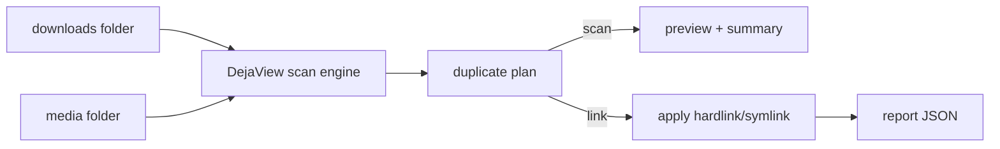
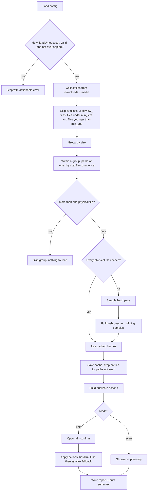
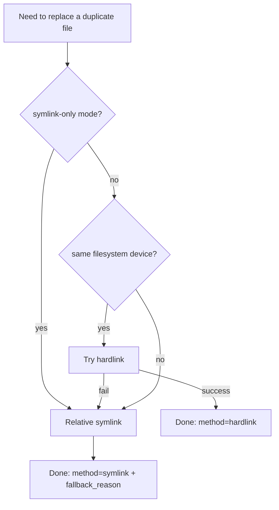
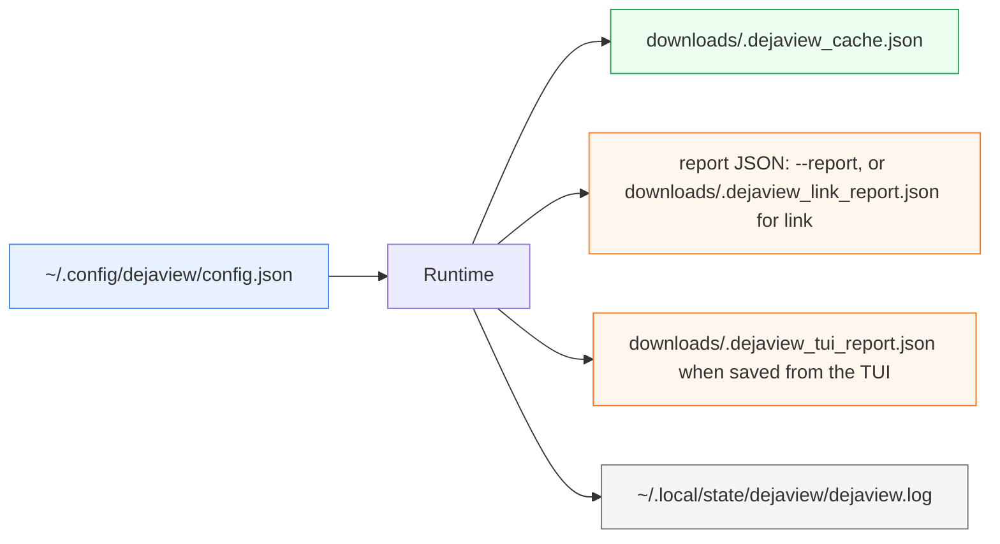
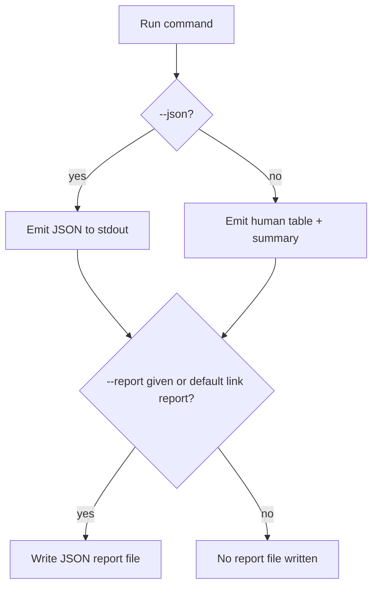

# DejaView: How It Works

This guide explains the app in simple terms and shows the flow with Mermaid diagrams.

## 1) Big Picture

DejaView compares two folders:
- `downloads`: where duplicates usually exist
- `media`: the canonical library, which DejaView only reads

It finds exact duplicates and can replace each duplicate file in `downloads` with:
- a hardlink (preferred when possible)
- a relative symlink (fallback)

The two folders must be separate: neither may contain the other.



## 2) CLI Command Map

```mermaid
flowchart TD
    ROOT[dejaview] --> SCAN[scan]
    ROOT --> LINK[link]
    ROOT --> TUI[tui]
    ROOT --> CFG[config]
    ROOT --> CACHE[cache]

    CFG --> SD[set-downloads]
    CFG --> SM[set-media]
    CFG --> SMA[set-min-age]
    CFG --> SMS[set-min-size]
    CFG --> ST[set-threads]
    CFG --> SFT[set-full-threads]
    CFG --> SEX[set-exclude]
    CFG --> SLM[set-link-mode]
    CFG --> CV[validate]
    CFG --> CS[show]

    CACHE --> CC[clear]
    CACHE --> CI[info]
    CACHE --> CAT[audit-temp]
    CACHE --> CCT[cleanup-temp]

    SCAN --> SJSON[--json]
    SCAN --> SREP[--report]
    SCAN --> SPROG[--progress/--no-progress]
    SCAN --> SSTRICT[--strict]
    SCAN --> SSYM[--symlink-only]

    LINK --> LJSON[--json]
    LINK --> LREP[--report]
    LINK --> LPROG[--progress/--no-progress]
    LINK --> LSTRICT[--strict]
    LINK --> LSYM[--symlink-only]
    LINK --> LCONF[--confirm]

    TUI --> TSTRICT[--strict]
```



## 3) Run Pipeline (Scan + Link)



A run started from the TUI can be cancelled at any point. During collecting and hashing it stops almost at once, even partway through a large file, and still saves the hashes it finished. During the apply step it stops before the next file.

## 4) Link Method Decision

Before any replacement, DejaView checks that the source is outside the media folder, that the target is inside it and is not a symlink, and that neither file changed since the scan.



Either link is created under a temporary name next to the download and then renamed over it, so the download is never missing.

## 5) What Gets Stored



## 6) Output Modes

- Human mode (default): table + summary in terminal
- JSON mode (`--json`): machine-readable JSON on stdout
- File report (`--report <path>`): same structured data saved to disk



## 7) First-Run Checklist

1. Set paths:
   - `dejaview config set-downloads /path/to/downloads`
   - `dejaview config set-media /path/to/media`
2. Validate setup:
   - `dejaview config validate`
3. Preview first:
   - `dejaview scan`
4. Apply:
   - `dejaview link --confirm`

## 8) Typical Examples

Preview (human):
```bash
dejaview scan
```

Preview (automation):
```bash
dejaview scan --json --no-progress --report /tmp/scan.json
```

Apply with confirmation:
```bash
dejaview link --confirm
```

Apply for automation:
```bash
dejaview link --json --no-progress --report /tmp/link.json
```
