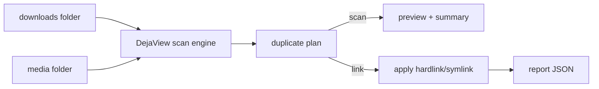
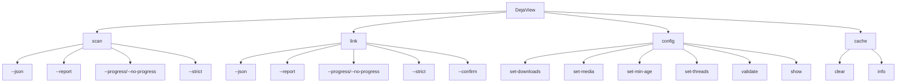
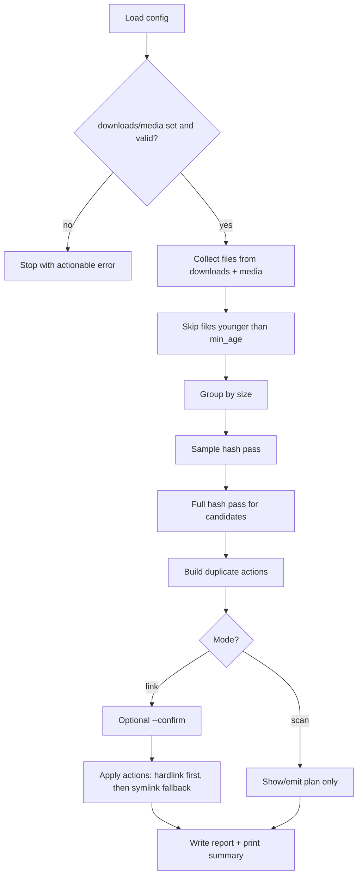
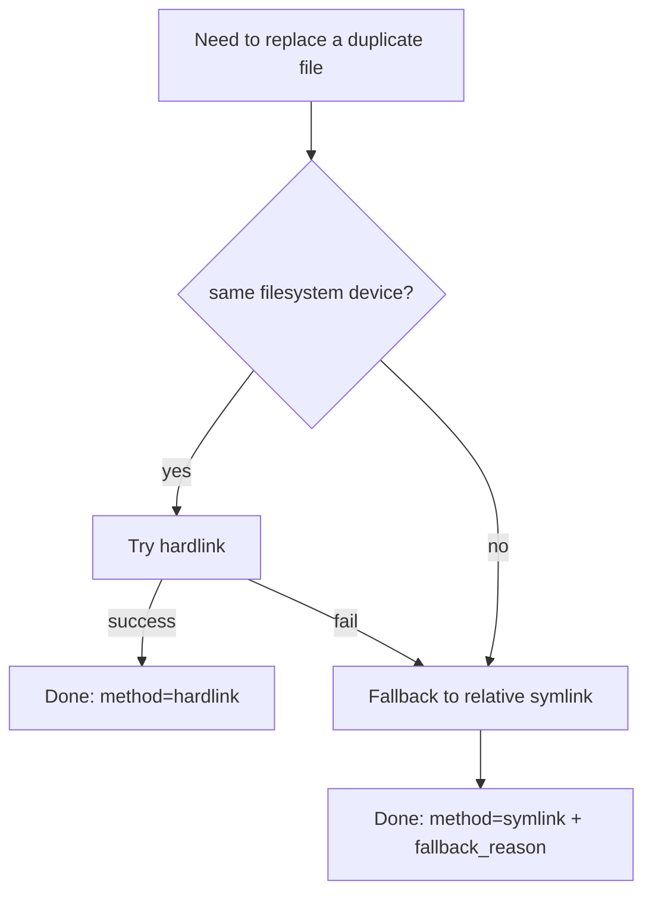
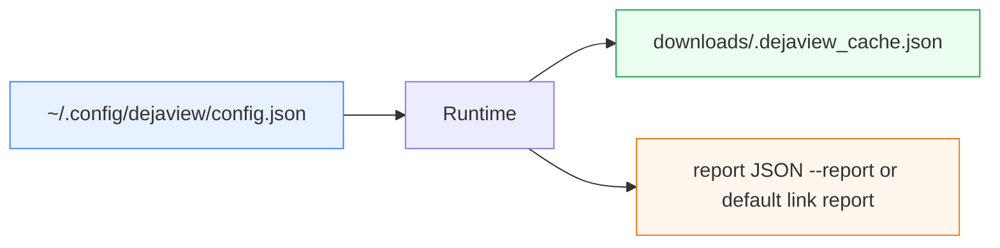
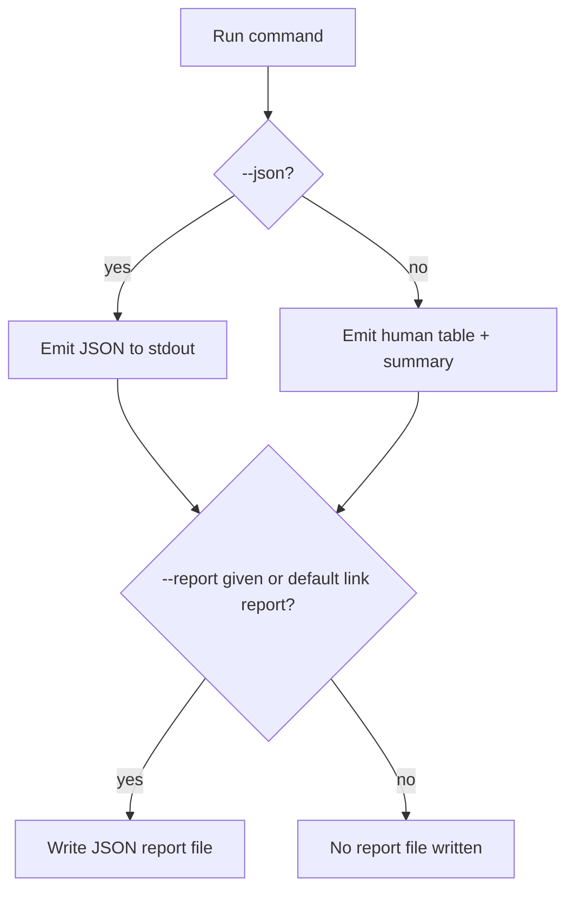

# DejaView: How It Works

This guide explains the app in simple terms and shows the flow with Mermaid diagrams.

## 1) Big Picture

DejaView compares two folders:
- `downloads`: where duplicates usually exist
- `media`: canonical library

It finds exact duplicates and can replace duplicate files in `downloads` with:
- hardlinks (preferred when possible)
- symlinks (fallback)



## 2) CLI Command Map



## 3) Run Pipeline (Scan + Link)



## 4) Link Method Decision



## 5) What Gets Stored



## 6) Output Modes

- Human mode (default): table + summary in terminal
- JSON mode (`--json`): machine-readable JSON on stdout
- File report (`--report <path>`): same structured data saved to disk



## 7) First-Run Checklist

1. Set paths:
   - `DejaView config set-downloads /path/to/downloads`
   - `DejaView config set-media /path/to/media`
2. Validate setup:
   - `DejaView config validate`
3. If testing with very fresh files, set:
   - `DejaView config set-min-age 0`
4. Preview first:
   - `DejaView scan`
5. Apply:
   - `DejaView link --confirm`

## 8) Typical Examples

Preview (human):
```bash
DejaView scan
```

Preview (automation):
```bash
DejaView scan --json --no-progress --report /tmp/scan.json
```

Apply with confirmation:
```bash
DejaView link --confirm
```

Apply for automation:
```bash
DejaView link --json --no-progress --report /tmp/link.json
```
