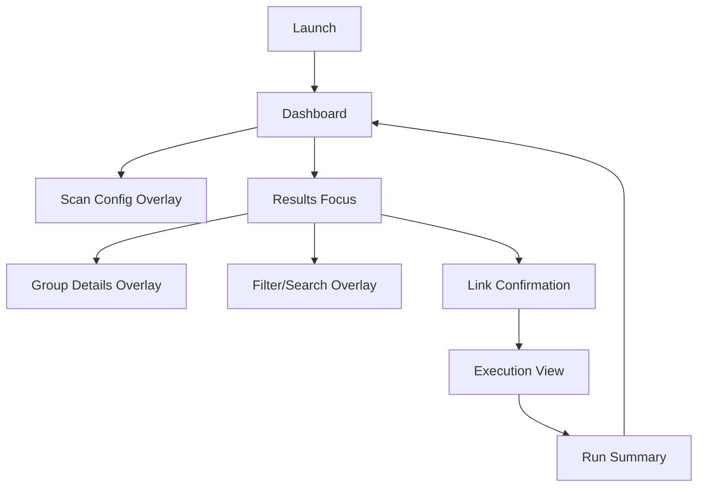

# DejaView TUI Blueprint (Ratatui)

> **Status: design history, not a reference.** This is the plan the TUI started from in March 2026. The TUI that shipped differs: each row is one planned link rather than one duplicate group, there is no filter, sort, command palette or focus cycling, and several keys mean something else (`S` scans, `X` rescans with a cleared cache, `l` links the selected row, `p` toggles path display, `c` cancels a run). The [README](../README.md#terminal-dashboard) lists the current keys and behaviour.

## 1) Design Goal
Build a fast, keyboard-first terminal UI that lets users:
- run scans and linking safely,
- inspect duplicate groups quickly,
- execute actions with strong confirmation and clear feedback,
- export machine-readable output without leaving TUI workflows.

This document is implementation-ready and intentionally keeps engine logic unchanged.

## 2) Information Architecture
Primary mode is an "Ops Dashboard" with 4 zones:

1. Top status bar
- Current mode (`Scan`, `Review`, `Link`, `Run`)
- Active profile/config summary (threads, min-age, strict/dry-run)
- Throughput counters (files scanned, groups, bytes recoverable)

2. Left pane: Context
- Scan targets
- Saved presets (quick switch)
- Recent runs list

3. Center pane: Results table (main focus)
- One row per duplicate group
- Columns: group id, files, wasted bytes, oldest/newest mtime, selected action
- Sort and filter support

4. Right pane: Details + action intent
- Selected group file list
- Canonical file choice
- Planned operation preview (`hardlink`, fallback `symlink`, or `skip`)
- Validation warnings

5. Bottom strip
- Live logs/events
- Progress bar or spinner
- Key hints

## 3) Core User Flows

### 3.1 First Run
1. User opens TUI.
2. Empty state explains required first action: add path(s) and start scan.
3. User configures options via quick controls.
4. Scan starts with visible progress.
5. Results table appears with default sort: highest wasted bytes first.

### 3.2 Review and Curate
1. Navigate groups with arrows/j/k.
2. Open details with Enter.
3. Mark action for selection (`link`, `skip`, `defer`).
4. Apply bulk actions by filter.
5. Review run summary preview before execution.

### 3.3 Execute Linking
1. Press `L` to initiate link run.
2. Confirmation screen shows safety checks and operation counts.
3. User confirms.
4. Run view streams progress and errors.
5. Completion panel offers copyable summary and report export.

## 4) Screen Map

## 5) Keyboard Model
Global keys (always active):
- `q`: quit current overlay or app (with safety prompt if running)
- `?`: help overlay
- `tab` / `shift+tab`: cycle focus pane
- `/`: open filter/search
- `:`: command palette

Dashboard/results keys:
- `j`/`k` or arrows: move selection
- `g` / `G`: jump top/bottom
- `enter`: open selected group details
- `space`: toggle select group
- `a`: select all visible groups
- `u`: unselect all visible groups
- `s`: cycle sort column
- `r`: reverse sort direction

Action keys:
- `l`: set action link for selected
- `x`: set action skip for selected
- `p`: preview plan (operations and fallbacks)
- `L`: execute linking workflow
- `d`: toggle dry-run
- `J`: export JSON report
- `R`: save report file

Scan/config keys:
- `n`: new scan target
- `e`: edit current config
- `t`: set threads
- `m`: set min-age
- `S`: toggle strict mode
- `P`: toggle progress mode

## 6) Focus and State Rules
- Exactly one focus target at any time: `left`, `center`, `right`, `bottom`, or `overlay`.
- Overlay focus is modal and blocks background actions.
- Long-running operations switch app state to `Running`; destructive actions are disabled.
- When run finishes, state transitions to `Review` and retains table position/filter.

App states:
- `Idle`
- `Scanning`
- `Ready` (results available)
- `ConfirmingLink`
- `Linking`
- `Completed`
- `Error`

## 7) Feedback and Safety
- Before link execution, show:
  - number of planned hardlinks,
  - number of symlink fallbacks,
  - number of skipped items,
  - strict-mode impact estimate.
- Error rows are inspectable; include path and reason.
- If user requests JSON output, run summary must remain parseable and stable.
- While linking, display a non-blocking event log and current item indicator.

## 8) Visual Language (Terminal)
- Keep color usage semantic:
  - primary accent for focus/selection,
  - warning for recoverable issues,
  - danger for failed operations,
  - muted for metadata.
- Use minimal borders; rely on spacing and section headers.
- Dense table with fixed-width numeric columns for quick scanning.
- Prefer clear text labels over icons.

## 9) Ratatui Implementation Skeleton
Suggested module split:
- `src/tui/mod.rs` - app bootstrap and public entry
- `src/tui/app.rs` - root app state and reducer/update loop
- `src/tui/events.rs` - keyboard/input and tick events
- `src/tui/layout.rs` - frame layout helpers
- `src/tui/view/` - per-screen rendering
- `src/tui/actions.rs` - command handlers mapped to engine calls
- `src/tui/model.rs` - view models for table/details/logs
- `src/tui/theme.rs` - colors/styles

Engine integration boundary:
- TUI calls existing engine APIs through a thin adapter.
- No business logic duplication inside view layer.

## 10) MVP Slice (Build Order)
1. Shell app with layout and focus cycle.
2. Results table + details pane bound to mock data.
3. Hook scan action to real engine and stream progress.
4. Add selection/actions model and link confirmation overlay.
5. Execute link run with live log + completion summary.
6. Add JSON/report export and settings overlay.

## 11) UX Acceptance Criteria
- New user can run first scan and understand next action in under 2 minutes.
- Power user can execute scan->review->link path without touching mouse.
- Action outcomes are explicit (hardlink, fallback symlink, skipped, failed).
- A single run can be consumed by humans in TUI and scripts via exported JSON/report.

